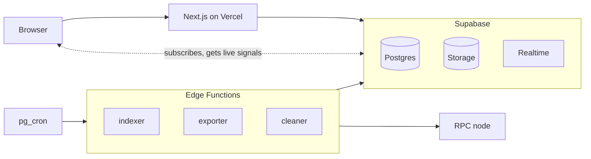

# Wallet activity

Reads ERC-20 transfers from an EVM chain. Anyone can see the latest transfers,
and each wallet owner can see their own.

**Status:** runs on Sepolia. The feed, wallet sign-in, live updates and CSV
export work; optional features from the requirements are not built.

## What it does

A pass runs on a schedule, reads a range of blocks, decodes `Transfer` events
and stores them for the last 14 days. It keeps its position in the database,
so it can stop at any point and continue later without gaps or duplicates. Records near the head of
the chain are not final until enough confirmations pass, and a replaced branch
is rolled back.

Transfers are public, as they are on the chain. You sign in with a wallet
signature to see your own transfers and exports. The address travels in your
token, and row-level policies in the database compare it against each row, so a
client can only read its own exports. The interface talks to the database
directly; there is no API layer in between.

## How it works



The browser never holds a secret key: Edge Functions use it, and the web
server acts as the signed-in user under row-level policies. How an indexer pass
works is in [ADR 04](docs/adr/04-reorg-handling.md), and how an export is built
is in [ADR 06](docs/adr/06-export-jobs.md).

## Stack

| Part         | Choice                                     |
| ------------ | ------------------------------------------ |
| Compute      | Supabase Edge Functions (Deno)             |
| Database     | Supabase Postgres                          |
| Schedule     | `pg_cron` through `pg_net`                 |
| Queue        | pgmq                                       |
| Chain access | viem                                       |
| Auth         | Supabase Auth, wallet signature (EIP-4361) |
| Interface    | Next.js on Vercel                          |
| Live updates | Supabase Realtime Broadcast                |

Nothing runs between passes. All state — position, queue, data — lives in
Postgres. See [docs/adr/01-stack.md](docs/adr/01-stack.md) for why.

## Running it

Requires Docker and Node 20.9+.

```bash
npm install                    # Supabase CLI and Deno, pinned
cp supabase/functions/.env.example supabase/functions/.env
# set CRON_SECRET in it: openssl rand -hex 32
npx supabase start             # local stack
npm run db:reset               # apply migrations, fill local Vault
npx supabase functions serve   # run functions; cron calls the indexer
```

After a change to `CRON_SECRET`, run `npm run db:seed:vault` and restart
`functions serve`.

```bash
cd web
npm install
cp .env.example .env.local     # add the publishable key from `npx supabase status`
npm run dev
```

No chain address, endpoint or key belongs in code. Secret keys are never
exposed to the browser.

## Deploying

Pushes to `main` deploy migrations and functions through the Supabase GitHub
integration, and the interface through Vercel from the `web` directory.

Secrets are set by hand, once per environment:

```bash
npx supabase secrets set CRON_SECRET=... CHAIN_ID=... RPC_URL=...
```

```sql
select vault.create_secret('https://<project-ref>.supabase.co', 'project_url');
select vault.create_secret('<the same CRON_SECRET>', 'cron_secret');
```

In Vercel, set the variables from `web/.env.example`: `NEXT_PUBLIC_SUPABASE_URL`,
`NEXT_PUBLIC_SUPABASE_PUBLISHABLE_KEY`, `NEXT_PUBLIC_EXPLORER_URL` and
`NEXT_PUBLIC_NETWORK_NAME`. Also turn on "Include files outside of the Root
Directory", because the web build imports `supabase/functions/_shared`.

## Layout

```
supabase/functions/   indexer, exporter, cleaner, _shared
supabase/migrations/  schema and policies
web/                  interface
docs/adr/             decisions
```

## Limits

- The native coin is not tracked: ETH transfers emit no log events
- History covers the last 14 days, not the whole life of a token
- One network at a time; network and contracts come from configuration
- The service never writes to the chain, and holds no private keys

## Docs

- [Vision and scope](docs/vision-and-scope.md)
- [01. Stack](docs/adr/01-stack.md)
- [02. History window](docs/adr/02-history-window.md)
- [03. Wallet address of a signed-in user](docs/adr/03-wallet-address.md)
- [04. Reorg handling](docs/adr/04-reorg-handling.md)
- [05. Live updates](docs/adr/05-live-updates.md)
- [06. Export jobs](docs/adr/06-export-jobs.md)
- [07. Export files](docs/adr/07-export-files.md)
