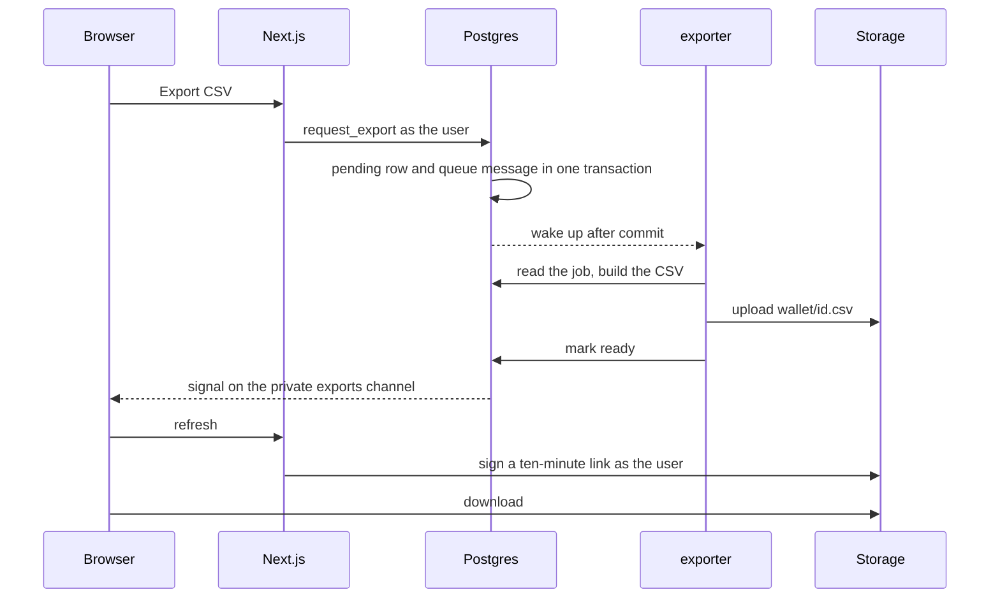

# 06. Export jobs

## Context

A signed-in user asks for their transfers over a period and gets a CSV file
later. Building the file must not block the request, and a failed build must
be retried.

## Decision

- **`request_export` in the database** inserts the `exports` row and sends a
  pgmq message in one transaction. It takes the wallet from `auth.jwt()`, and
  the web server calls it as the user.
- **One `pending` export per wallet,** checked in the function and enforced by
  a partial unique index against races.
- **The `exporter` function is woken at once through `pg_net`,** and `pg_cron` runs it every
  minute for retries and lost calls.
- **Three attempts, five-minute visibility timeout,** then the export is
  `failed`.
- **A status change signals the private channel `exports:<wallet>`,** which
  only the owner can listen to.
- **Transactions stay in SQL functions** for now, as in the indexer. Moving
  them to a direct Postgres connection is a later decision.

FR-8 puts the queue under catch-up, but building files is the work that needs
one, so the queue serves exports.

## Flow

