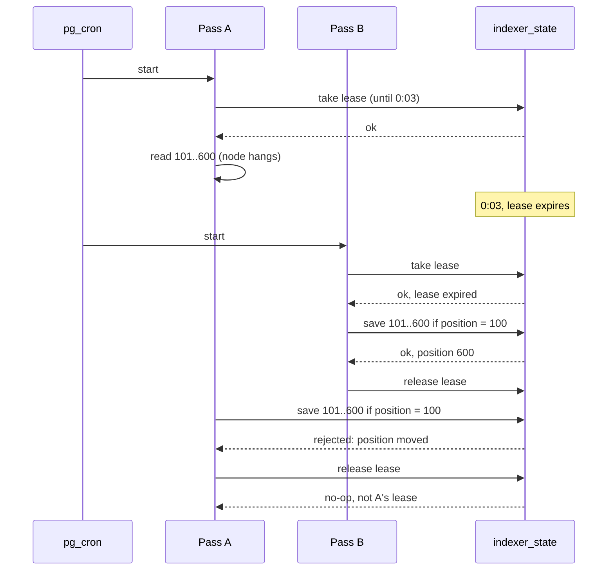

# 09. Indexer pass lock

## Context

Cron starts an indexer pass every minute, and a pass can run longer than that.
The pass reaches the database through the Data API, where each call is its own
transaction.

## Decision

- **A lease row, not an advisory lock.** A lock does not live across API calls.
- **The lease ends after 3 × `PASS_SOFT_LIMIT_MS`,** so a pass that died blocks
  the indexer for minutes, not forever.
- **Each save checks the position,** so a pass that outlived its lease cannot
  overwrite newer work.
- **Add a heartbeat** if `position moved` shows up in the logs.

## Flow

